# pmx2aster.py


FEA translator from PrePoMax (`*.inp`) format --> code_aster
\
code_aster files generated: `*.export`, `*.msh` (ascii mesh, sets), `*.comm` (input deck)

## 1.- Preamble

This started as a fairly crude python convertor to handle most things from PrePoMax --> code_aster for **linear** structural assemblies: statics & dynamics. As I learnt (very painfully) that code_aster syntax and ways can sometimes change in a cumbersome way, the code slowly became a monolith 'brick'. However, it does work with a general method, as shown in notes and examples provided.

There is no users' help doc except for the notes below and in `CHANGELOG.md`, and it often relies on hand edits in PrePoMax **'Keywords Editor'** or input deck (`*.inp`), for the translator to make sense on features / elements missing in PrePoMax UI, and to bypass some odd quirks specific to the `Calculix` (CCX) solver syntax.

The main reason behind this work specific to `code_aster` (CA), is that the `CCX solver` (as far as my testing went in 2024) seems quite limited in terms of building complex FEA linear assemblies correctly, since it doesn't seem to handle suitably rotational degrees-of-freedom (**'DoF'**) at single nodes on springs and on reference nodes at couplings (mainly on soft/distributing ones), without over-constraining models up by **'rigid'** equations/MPCs/connections/Rigid Body, etc.

*DISCLAIMER_1*: This translator covers LINEAR applications in code_aster (CA). My CA non-linear tests done to date, do not inspire a lot of confidence, specially for large displacements/rotations, so better leave them all out for now, and the syntax is even more cumbersome than the linear commands...

*DISCLAIMER_2*: All test work performed around this translator was done with the following tools and versions:

```text
PrePoMax V2.4.0 ──> code_aster for Windows V16.7 ──> ParaView V5.13
```

The output from the translator requires to launch code_aster from a terminal: `code_aster *.export`
\
code_aster = `path-to\v2024\16.7\bin\run_aster.bat`

Download here: [code_aster for Windows V16.7](https://simulease.com/wp-content/uploads/2025/05/code-aster_v2024_std.msi) ; 1CPU windows solver. Any other versions, and I don't know how it'll pan out because of possible syntax changes in CA.

## 2.- Building Blocks for LINEAR FEA Assemblies

There is a well established (over decades within pro FEA teams using commercial solvers) FEA methodology to build LINEAR structural assemblies (statics & dynamics), which rely only on a few key building blocks implemented correctly in a FEM linear solver. This general method not only covers how-to for most complex linear assemblies, but it also works with all commercial solvers I've ever used; i.e. one general method should hit (nearly) all linear applications.

Understanding a complete linear structural assembly on a Baseline design, specially at design concept stage, is **critical** before turning any non-linear terms on, if applicable/available. I see quite often newcomers starting with non-linear FEA models. I'd say, you need to understand the basic principals first with a linear assembly. Answer all the questions raised by that model, and ONLY start moving into non-linear, after the hard work has been done on linear checks and understanding.

I make the point of using the term `Assembly` in FEA intentionally. The reason is quite simple: I don't know of any relevant complete product, that needs simulation work, that is made up of a single part. FEA in-production is all about understanding assemblies. Single part tutorials/tests are a start, but don't cover anywhere near the complexity of real assemblies. The latter should **allow for fast & informed decision making** on a design.

### **Main linear building blocks**

#### 2.1 **ELEMENT TYPES**

- Robust solid high-order elements, specially `TET10` ones for fast meshing. I see more recently a fashion on `HEX` meshes. Fine, but time consuming, and in my opinion, they bring little benefit (if any) to linear assemblies. But yes, they look pretty...
- Shell elements correctly implemented. It is solver and application dependant whether we should use low-order and/or high-order (curvature) shells. Do your testing for your needs, check the NAFEMS benchmarks out.
- BEAM elements, used a lot e.g. in aerospace for good reason; but can be replaced (stiffness wise) by 2-node springs that handle 6K stiffness values as input.
- COUPLINGS, both rigid (kinematic, RBE2, LIAISON_SOLIDE, etc) and soft (distributing, RBE3, interpolation, LIAISON_RBE3, remote load, etc ) ones. These are elements too, as part of the model definition, and are one of the key players for this assembly general method to work correctly. See their section further down, and why they are so relevant.
- 2-node (or 1-node to-ground) SPRING elements. These are key on this general method for joints and correct local constraints per DoF. They have their own section below.
- Mass / Inertia point-elements. They must handle 6DoF (to include inertia terms: Ixx, Iyy, Izz) and be applicable to spring nodes and/or couplings' reference nodes.

#### 2.2 **COUPLINGS** x 2 types

- **SOFT** (distributing, RBE3, interpolation, LIAISON_RBE3, remote load, etc ) ones.
- **RIGID** (kinematic, RBE2, LIAISON_SOLIDE, etc) ones. Not recommended.
  
These must work on the reference single node for all 6 DoF (3 translations + 3 rotations), and (crucially) for both loads (force & moment vectors) and constraints (3 translations + 3 rotations fixings), which means they can be used in joints in combo with 6K springs. More on that in next section.

This is the area where I see misconceptions in structural FEA. I see quite a lot of online work calling **rigid** links/couplings/rigid body to build assemblies. This is conceptually incorrect, and the reason is simple: there isn't a single real structure out there where a surface is fully rigid, it just doesn't exit, and that matters a lot in FEA. Everything moves/distorts even if microns, and that can matter significantly.

The moment you apply a rigid condition onto a surface, or group of nodes, that area cannot expand/contract under thermal loads, nor deform correctly under torsional & bending moments, the latter happens in ALL real structural assemblies.

> [!TIP]TIPS
>
> - stick to SOFT couplings and understand them inside out. Avoid any rigid connections at all costs, unless you are testing/debugging a model up, to isolate sensitivity on different areas of the model.
>
> - use the reference node on a soft coupling to apply force & moments vectors and/or any constraints at a surface (or node set). Then you are dealing only with a single node to dial in the exact load you want, and to output the reactions when constrained, per DoF in order to sanity check your assembly fast.

#### 2.3 **SPRINGS** (6K values)

CBUSH (Nastran), connector (cartesian + rotation) in Abaqus, etc.

Springs must work via 6 K (stiffness) values on a **2-node-spring** line element; or on a single node for a **spring-to-ground**.

They are **crucial** to build linear joints with realistic compliance on complex structural assemblies with a pair of ‘soft’ couplings. The two couplings reference nodes are used by the 2-node spring element. Or one soft coupling at a load / constrained area, with the latter having a spring-to-ground.
Quite often they are zero length springs; e.g. the 2 races on a bearing (with axial, radial & tilting K values), a ball joint (only translation K values, zero K on rots), a slider, etc.
  
Once you have the 'combo' of 2 x soft couplings + 1 6dof_spring, then magically you can model any   structural linear joint you like, and works a treat as a general method. You only need to think in terms of `6 DoF:6 K` and apply to any of the 6 spring K values either zero or low (free to move) or high and/or measured K values.

For the high end K values, try not to use artificially high numbers, that local stiffness gradient doesn't exist in real life, and will cause all sort of trouble once you start adding non-linear terms to a sanity checked linear assembly. A good starting set of values for models in mm is: **K x,y,z = 1E+06N/mm & K rx,ry,rz = 1E+08Nmm/rad**. These come from experience.

*NOTE*: in aerospace (and others) it is very common to use beams instead of springs, for very good reasons. However, the thinking behind the building method is the same, rotations/moments must be understood by the solver at both ends of any line elements used, when required/applicable.

#### 2.4 **TIED** contact constraints

These allow for very fast building of FEA assemblies with many parts. Use PrePoMax (excellent) auto-pairs finder tool, check/merge/edit them, and done.

A mesher deals only with one part at a time; i.e. easy to mesh, and we **glue** them via TIED contact constraints with a tolerance (adjust) to overcome small gaps/overlaps in CAD, very common in a fast CAD/FEA production environment during development of new complex designs.

Furthermore, they allow to get sensible stresses across parts with different materials. If you 'weld' (shared nodes) meshes at pre-processing or badly MPC them, the shared nodes across parts (with different materials) will get the stresses averaged wrong.

I see online claims that TIED pairs cannot predict contact separation. Technically correct, BUT they will tell you if they want to separate by simply plotting the contours of the stress in the normal direction to a surface (or `signed von Mises`), and show in the contours any tensile stress in a different colour from compressive ones. Very useful and fast! Then, you may have some evidence to support the idea of going into non-linear contacts or not. Deadlines & budgets are always looming, be practical and fast providing enough evidence on modelling methods.

> [!NOTE]NOTE
> Only with those FEA building blocks implemented properly in a solver, and understanding the implications of 'soft' couplings vs 'rigid' ones, plus how a true 6K spring element should work, you should be able to build pretty much any linear structural assembly, no matter how complex it may look from CAD.
> \
> The currency here is degrees-of-freedom (DoF), on loads, constraints and joints. Once that is understood correctly, the imagination is the limit on (most) linear assemblies.

#### 2.5 Automated TABLE Outputs for **fast Sanity Checks**

The translator will try to make sense of the assembly setup (to some extent) in terms of loads and constraints, and write code_aster commands in its input deck (`*.comm`) for automated output of useful summary tables into the text results file (`*.dat`). Check the `*.export` file written by the translator to understand input and output files for the code_aster run, also you may need to edit the RAM allocation to your machine spec.

The objective of these tables is to perform instant sanity checks without even having to open the 3D results viewer. Furthermore, the TSE (Total Strain Energy) tables are invaluable towards design recommendations via a fast method. More on that further down.

##### 2.5.1 TABLE breakdown per part of CoG, mass & inertia values

This table checks that units are sensible, and any possible mistakes on material assignment and/or at CAD drafting on parts; it does happen. It requires to add the density to linear materials, which is always a good practice, even for linear statics; e.g. gravity loads handling.

**Example output table** in `*.dat` results file:

```text
--------------------------------------------------------------------------------

ASTER 16.07.09 CONCEPT 000001ea CALCULE LE 29/10/2026 A 11:11:22 DE TYPE        
TABLE_SDASTER                                                                   

            Total Mass / Inertia (ALL)
            ==========================
LIEU                    , CDG_X       , CDG_Y       , CDG_Z       , MASSE       , IX_G        , IY_G        , IZ_G        
shaft_els               ,       72.024,       1678.5,       102.61,       0.1523,       7185.3,       5312.3,       4766.1
in_race_els             ,  -0.00024326,         1263,  -1.4274E-05,    0.0058807,       21.868,       38.224,       21.868
out_race_els            ,     0.000189,         1263,   -0.0001158,      0.01213,       171.41,       331.44,       171.41
Mass_1_RP_RP_load       ,        90.47,       2050.5,       312.76,         0.05,            0,   1.0097E-29,   1.0097E-29
UNION_GROUP_MA          ,       70.322,       1728.9,       141.91,      0.22031,        18904,       7849.3,        14537
```

> [!TIP]TIP
> NOTE the parts' names in tables correspond to PrePoMax element set names per part: `part_name_els`, and when you assign sections in PrePoMax you need to use the previously created element set names, rather than selecting Parts.

##### 2.5.2 TABLE with Sum of reaction forces/moments from all constraints, and per LC
  
This is the 1st quick check that any FE analyst should do, to make sure the setup is not ‘eating’ any load out, not rare on complex setups. Specially TIED contacts can over-constrain rigid body like rotations; i.e. an invisible artificial constraint. Loads IN must come the other end at constraints via reactions OUT, to balance a model in statics. If not, wrong model and/or setup is quite likely.

The table should summarise sum of reactions per loadcase (LC) & per DoF, for fast and easy reading in an editor. It is quite common at design concept stage for assemblies to run 9 unit-like statics LCs: 3 x Forces (Fx, Fy, Fz) + 3 x Moments (Mx, My, Mz) + 3 x 1G gravity LCs (Gx, Gy, Gz). All in separate LCs per DoF and/or type. This makes sanity checks on the sum of reactions instant, as we know what we put in on each DoF / load type. This is a very common method to debug dodgy tied pairs, joints and/or over-constraints.

**Example output table** in `*.dat` results file:

```text
--------------------------------------------------------------------------------

ASTER 16.07.09 CONCEPT 000001ed CALCULE LE 29/10/2026 A 11:11:34 DE TYPE        
TABLE_SDASTER                                                                   

            ALL nodes, Total Sum of Reactions: Forces & Moments
            ===================================================
NUME_ORDRE  , NOM_CHAM        , RESULT_X    , RESULT_Y    , RESULT_Z    , MOMENT_X    , MOMENT_Y    , MOMENT_Z    
           1, REAC_NODA       ,        -1000,   1.0303E-11,  -8.6509E-13,  -4.4593E-09,  -3.1276E+05,   2.0505E+06
           2, REAC_NODA       ,   5.6044E-13,        -1000,   1.4557E-12,   3.1276E+05,  -2.1174E-11,       -90470
           3, REAC_NODA       ,  -7.6383E-14,  -6.8283E-12,        -1000,  -2.0505E+06,        90470,   2.1914E-09
           4, REAC_NODA       ,  -2.6277E-12,  -1.8098E-11,   9.6936E-12,       -1E+06,   2.2146E-10,  -3.3865E-09
           5, REAC_NODA       ,  -1.1831E-11,   3.6676E-13,   1.1298E-12,   4.4347E-09,       -1E+06,  -9.9317E-09
           6, REAC_NODA       ,  -4.7073E-13,   8.9244E-12,   1.4522E-13,  -6.3012E-09,   1.8457E-10,       -1E+06
           7, REAC_NODA       ,      -2203.1,   6.7146E-12,   3.4914E-12,   -9.778E-09,  -3.1265E+05,    3.809E+06
           8, REAC_NODA       ,  -8.8285E-13,      -2203.1,   5.9863E-13,   3.1265E+05,  -3.9563E-11,  -1.5493E+05
           9, REAC_NODA       ,   3.6176E-12,  -7.6739E-12,      -2203.1,   -3.809E+06,   1.5493E+05,  -8.3696E-10
```

Similar **tables are automated for each TIED pair** in the model, make sure the moments' sums make sense:

```text
--------------------------------------------------------------------------------

ASTER 16.07.09 CONCEPT 000001f1 CALCULE LE 29/10/2026 A 11:11:38 DE TYPE        
TABLE_SDASTER                                                                   

            Total Sum: TIED Forces & Moments: pair Tie_shaft_to_bear
            ================================
NUME_ORDRE  , NOM_CHAM        , RESULT_X    , RESULT_Y    , RESULT_Z    , MOMENT_X    , MOMENT_Y    , MOMENT_Z    
           1, FORC_NODA       ,         1000,    0.0017399,   0.00036494,      0.39042,   3.1276E+05,  -2.0505E+06
           2, FORC_NODA       ,   0.00024699,         1000,   0.00014115,  -3.1276E+05,   -0.0033712,        90470
           3, FORC_NODA       ,  -0.00032715,  -0.00035911,         1000,   2.0505E+06,       -90470,      0.45954
           4, FORC_NODA       ,  -0.00037804,  -0.00046587,  -0.00039584,        1E+06,     0.012942,      0.53815
           5, FORC_NODA       ,   0.00032488,   8.3079E-06,    0.0013225,       1.7127,        1E+06,     -0.40919
           6, FORC_NODA       ,   0.00091369,   -0.0022291,   9.9814E-05,      0.23406,   0.00049481,        1E+06
           7, FORC_NODA       ,       2023.8,    0.0022596,   0.00036983,      0.37199,   3.1265E+05,  -3.5826E+06
           8, FORC_NODA       ,   0.00035353,       2023.8,   0.00015594,  -3.1265E+05,   -0.0027142,   1.5492E+05
           9, FORC_NODA       ,  -0.00044072,  -0.00046278,       2023.8,   3.5826E+06,  -1.5492E+05,      0.61614
```

Same goes for **Modal Analysis** auto table:

```text
--------------------------------------------------------------------------------

Modal Results Table                                                             

    Modal (Freqs(Hz), Participation Factors, Effective Mass)
    ========================================================
NUME_ORDRE  , FREQ        , FACT_PARTICI_DX, FACT_PARTICI_DY, FACT_PARTICI_DZ, MASS_EFFE_DX, MASS_EFFE_DY, MASS_EFFE_DZ, MASS_GENE   , RIGI_GENE   
           1,       5.8673,       -0.091526,        -0.33403,          1.1358,     0.000965,     0.012853,      0.14862,       0.1152,       156.56
           2,       5.9557,          1.2887,        -0.20872,        0.043272,      0.16312,    0.0042785,    0.0001839,     0.098213,       137.53
           3,       21.942,         0.25156,       -0.047831,        0.039197,    0.0026911,    9.729E-05,   6.5337E-05,     0.042526,       808.27
           4,       185.51,         0.22135,          1.0102,         0.61298,    0.0048439,      0.10089,     0.037146,     0.098859,   1.3431E+05
           5,       267.85,         0.40772,         0.20754,         -0.1815,     0.018611,    0.0048223,     0.003688,      0.11196,   3.1711E+05
           6,       359.72,       -0.074933,         0.79546,        -0.10898,   0.00067812,     0.076418,    0.0014345,      0.12077,   6.1695E+05
           7,       458.51,       -0.003372,      -0.0039055,      -0.0044261,   8.8057E-08,   1.1813E-07,   1.5172E-07,    0.0077443,        64275
           8,       458.53,       0.0033643,      -0.0018171,      -0.0030588,   1.1491E-07,   3.3522E-08,   9.4992E-08,     0.010153,        84270
           9,       623.72,        0.011045,         0.31888,       -0.097199,   8.2408E-06,     0.006869,    0.0006382,     0.067551,   1.0375E+06
          10,       857.44,         0.13969,        -0.15117,       0.0029469,    0.0015232,    0.0017839,   6.7788E-07,     0.078058,   2.2656E+06
```

This is all about fast checks before one even opens the 3D results viewer, often the tables inspection is enough to go back and fix something in an assembly model. It is also evidence, e.g. in front of a Chief Engineer, that you have performed all the basic checks.

##### 2.5.3 Sum of Total Strain Energy (TSE) on a per part & per LC basis

This is invaluable with assemblies for debugging and to start issuing design recommendations. High TSE on some parts normally means they should be optimised for stiffness. Low TSE contribution, then optimise for light-weighting.
Then here, you also output TSE for all joints (springs) and then you get a complete preliminary picture of your Baseline assembly with a single modelling/output method.

Example of **TSE breakdown table for the complete assembly**:

```text
--------------------------------------------------------------------------------

ASTER 16.07.09 CONCEPT 000001eb CALCULE LE 29/10/2026 A 11:11:27 DE TYPE        
TABLE_SDASTER                                                                   

            ASSY - Total Strain Energy - Statics (TSE)
            ==========================================
NUME_ORDRE  , INST        , LIEU                    , ENTITE  , TOTALE      , POUR_CENT   
           1,            1, 00000002                , TOUT    ,       3673.9,          100
           2,            2, 00000002                , TOUT    ,       546.91,          100
           3,            3, 00000002                , TOUT    ,         3204,          100
           4,            4, 00000002                , TOUT    ,       5187.2,          100
           5,            5, 00000002                , TOUT    ,       5204.6,          100
           6,            6, 00000002                , TOUT    ,       5197.1,          100
           7,            7, 00000002                , TOUT    ,       5867.5,          100
           8,            8, 00000002                , TOUT    ,       630.46,          100
           9,            9, 00000002                , TOUT    ,         5476,          100
```

Example of **TSE breakdown table on a per part** basis:

```text
--------------------------------------------------------------------------------

ASTER 16.07.09 CONCEPT 000001ec CALCULE LE 29/10/2026 A 11:11:33 DE TYPE        
TABLE_SDASTER                                                                   

            Total Strain Energy - Statics (TSE - ALL)
            =========================================
NUME_ORDRE  , INST        , LIEU                    , ENTITE  , TOTALE      , POUR_CENT   
           1,            1, shaft_els               , GROUP_MA,       74.578,         2.03
           1,            1, in_race_els             , GROUP_MA,       7.4541,      0.20289
           1,            1, out_race_els            , GROUP_MA,       1.4443,     0.039312
           1,            1, spr_bear                , GROUP_MA,       3590.4,       97.728
           2,            2, shaft_els               , GROUP_MA,       15.165,       2.7728
           2,            2, in_race_els             , GROUP_MA,       0.9315,      0.17032
           2,            2, out_race_els            , GROUP_MA,      0.28771,     0.052606
           2,            2, spr_bear                , GROUP_MA,       530.53,       97.004
           3,            3, shaft_els               , GROUP_MA,       55.578,       1.7346
           3,            3, in_race_els             , GROUP_MA,       4.7825,      0.14927
...
...
           7,            7, out_race_els            , GROUP_MA,       2.4598,     0.041922
           7,            7, spr_bear                , GROUP_MA,       5759.3,       98.157
           8,            8, shaft_els               , GROUP_MA,       17.907,       2.8404
           8,            8, in_race_els             , GROUP_MA,       1.1571,      0.18354
           8,            8, out_race_els            , GROUP_MA,      0.46773,     0.074188
           8,            8, spr_bear                , GROUP_MA,       610.93,       96.902
           9,            9, shaft_els               , GROUP_MA,       74.837,       1.3666
           9,            9, in_race_els             , GROUP_MA,       8.0859,      0.14766
           9,            9, out_race_els            , GROUP_MA,       2.5212,      0.04604
           9,            9, spr_bear                , GROUP_MA,       5390.6,        98.44
```

The same auto-table system goes for a modal analysis, you get the TSE breakdown per part and per mode, incredibly useful in dynamics!

> [!TIP]TIP
> To convert the tables output in `*.dat` file into excel graphs, use `code/fea2excel.py`. This allows for super-fast visual sanity checks on the results. Specially useful for the TSE method breakdown when assemblies have many parts. It is magic, and instant to spot errors and/or start gauging based on TSEs what parts are candidates for light-weighting (low TSE %), and which ones need stiffness optimisation (high TSE %). Also, TSE on the assembly tells you which loadcase is the killer one in terms of stiffness and energy used to take the loads in.

Example of useful TABLE graphs from `fea2excel.py` on an assembly:

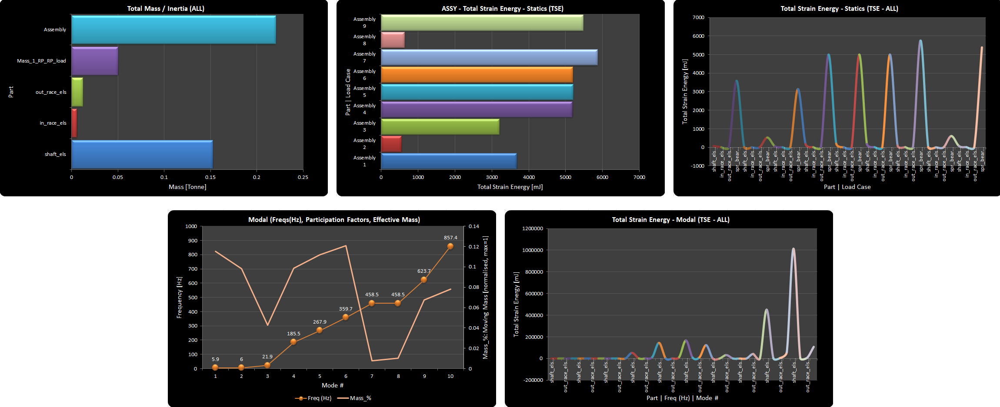

## 3.- Some Features & PrePoMax How-To's

As already explained, code_aster UX side of things is quite poor, in my opinion. I'll do my best to summarise what the translator needs; but by far, the best way is to inspect the models and input files provided in each example's folder. It took me a long time to get my head around code_aster ways for assemblies, and as a result it is only by looking at the examples that one can remember what's what...
That is actually the very reason I started writing this code, because after adding a few features, I couldn't possibly remember CA syntax and quirks, hence automating it via this py.

### 3.0 Getting started with a PrePoMax assembly template

Easiest way is to copy one of the small assy models provided in the examples, which carries over the workflow in PrePoMax. Once you got your head around linear assemblies, in general; import your CAD assy in the Geometry tab. Then use the magic `Swap Parts` tool, that is a *stroke of genius*, that is. PrePoMax then should re-build pretty much the complete new assembly after meshing the new parts. You'll need to check on element and node sets and surfaces, plus any hand edits in the keywords editor.

> [!TIP]TIPS
> When building FE models, be fussy about naming conventions on parts, node sets, element sets and surface names, if applicable. It's time consuming and boring, but it really pays off later on. They provide means of automating your specific workflows, and importantly, passing workflows onto colleagues, it's all about **team work**.
>
> Furthermore, having sensible names equal in the UI and the solver keeps the source of the truth linked up in debugging and post-processing, plus, again, provides solid methods for colleagues to pick your work up fast when you are not around.

### 3.1 PART (element sets) names and Section Assignment

For the translator to work as intended, create in PrePoMax one element set per part (e.g. `part_name_els`); then use those to assign sections later on. These part names will then appear in the code_aster `*.msh`, `*.msg`, `*.comm` & `*.dat` files; and the legends in excel plots.

### 3.2 COUPLINGS in PrePoMax

I used at the time, the generic *Rigid Body* entity in the UI, just to give me the sets & RPs I need for the 2 types of couplings as follows:

- If the Rigid Body name is pre-pended by `rigid_`, the translator will write a rigid coupling.
- Anything else, by default, it writes a SOFT coupling, the recommended way.

All else should be automated from that. For force / moments load vectors and constraints, the translator expects that reference nodes on SOFT (or rigid) couplings are used.

### 3.3 TIED Pairs in PrePoMax

This is business as usual, use the `*Tie` constraint in the UI. You don't need to create surfaces, select them on the fly, the translator should handle the rest and the very long names output by PrePoMax on set names off ties. The translator cleans all those up, so that we keep the source of the truth vs the UI names in tree.

Also, remember to use the `position tolerance` if/when required, the translator also handles that one. And, don't forget for large assemblies with many parts, to use the great auto-pair finder in PrePoMax.

As already described, the translator will auto-write tables to check on Forces / Moments per DoF, overall sums on each TIED pair, this is key to always check that they make sense.

### 3.4 Point MASS / INERTIA elements

You can use the mass entry in PrePoMax if you only need that value. But, in reality to model the mass/inertia contribution of a part modelled like that, attached to the assembly via a SOFT coupling, you should always use a mass / inertia point-element.
This is done in the keywords editor, reusing the elset from an RP; e.g.:

```ini
** point mass-inertia element
*Mass, Elset=Point_Mass-1_RP_RP-2
0.001, 1., 0.2, 0.03
```

### 3.5 SPRING elements

This is quite painful in PrePoMax since it doesn't support line elements between RP (points). So, back to the keywords editor I'm afraid, e.g.:

```ini
** USER elements and sets
** 2-node spring, bearing K
*user_Element, type=spring_6
20001, 32640, 32642
*Spring_6, Elset=spr_bear
1e6, 1e6, 1e6, 1e8, 1e8, 1e8
*Elset, Elset=spr_bear
20001
**
```

This is an area where it pays off to be fussy about set names, it is key. The translator requires custom element types: `spring_6` for a 2-node spring, and `ground_spring_6` for a 1-node spring-to-ground. Then for the stiffness assignment 2 custom commands: `*Spring_6` & `*Ground_spring_6`.

The translator should also support node set names in the spring definition, instead of IDs, BUT PrePoMax doesn't provide from the UI a node set creation from an RP, so back to manual checks, etc... Look in examples for cases on how to do those.

### 3.6 LOADS & CONSTRAINTS

This is also painful in PrePoMax because it follows this (very) strange syntax in Calculix of a dummy 2nd repeat node whenever we need to apply **moments or constraints on rotations**.

I haven't found an easier way around but painfully copy/paste in keywords editor across STEP definitions the moments or rots constraints as required. Again, because of the lack of UI node sets on RPs, it's not easy to use node set names, which would automate it when we re-mesh parts:

```ini
** Name: fix-1
** Add last 3 lines by hand on same constrained (coupling) node.
** Then copy across STEPs as required
*Boundary
1, 1, 1, 0
1, 2, 2, 0
1, 3, 3, 0
1, 4, 4, 0
1, 5, 5, 0
1, 6, 6, 0
```

```ini
** Name: Moment-1
*Cload
3, 4, 447.213
```

The translator also handles **vector pressure loads and normal pressures** on surfaces. Give it a shot if you need them, see what happens.

Static **gravity loads** just needs an entry in PrePoMax on any (dummy) element set, and the translator will apply by default the gravity loads over the full assembly, including any mass/inertia point-elements, if present.

### 3.7 Linear STATIC Loadcases

In PrePoMax we need a linear static STEP entry per loadcase, typically common constraints are propagated across them. The translator will 'lump' all static loadcases onto a single code_aster STEP: Multi loadcase via linear MECA_STATIQUE, [K] matrix re-use solver; i.e. fast runs for linear stuff. It assumes you are not switching constraints across linear loadcases; or else you'll need to split them across separate STEPs in CA.

### 3.8 Modal Analysis

This is just a `*Frequency` STEP in PrePoMax. Use number of modes, rather than a freq range. It is quite common on a 1st modal check run on an assembly to get the 1st 6 modes, to make sure all low frequency content makes sense. Use hand calcs when possible using the modal table output information to check on predicted frequencies.

omega = sqrt(K/M); omega = 2PI * Freq(Hz), K = stiffness, M = moving mass in a mode, not the complete assembly mass.

### 3.9 Modal (transient) Forced Response

The type I've tested the most is a `*Modal dynamics` type, with shock half-sine wave ACC events at the base motion of a structure. Better look for an example in the provided test suite under the `examples` folder. It's a well established and general approach in modal superposition methods, nothing new.

See example below, note the base motion line from keywords editor. The translator will take that and do some magic generating the corresponding time domain amplitude curves, etc for all to work; he said ...

```ini
** Name: Step-10
**
** Step-11 +++++++++++++++++++++++++++++++++++++++++++++++++
**
*Step, Inc=100
*Modal dynamics
0.1, 1
**
** Damping +++++++++++++++++++++++++++++++++++++++++++++++++
**
*Modal damping
1, 1000000, 0.03
**
** Boundary conditions +++++++++++++++++++++++++++++++++++++
**
*Base motion, Type=Acc, DOF=1, Amplitude=input_G, Shock time=11ms
**
```

### 3.10 SUB-MODELLING Technique

This is supported too, as it is the best and fastest method you'll ever have for accurate stress prediction at hot-spots. Look it up, is a general method. You need to solve 1st a GLOBAL (coarse) model, identify relevant stress hot-spots, build little CAD local models as required with flat cut planes, and execute the Sub-Modelling tech. Magic, you can also have many local models in one solve, and it is very fast to solve since it is (normally) driven by constraints already calculated in the global model.

It works for both statics and linear dynamics. In latter, the local model is small enough not to affect the modal content, which is nearly always the case on stress hot-spots.

Look it up in examples, e.g:

```ini
**
** Submodel ++++++++++++++++++++++++++++++++++++++++++++++++
**
*Submodel, Type=Node, Input="global_R3_coups_2_cubes.rmed"
cut_pZ
cut_mZ
```

You need to get familiar with the `*.export` input file provided with comments by the translator. You'll see at the bottom the syntax for writing and/or reading results for re-starts.

When solving linear dynamics forced response cases, it is common practice to fine tune the modal analysis 1st on it's own, write the results for all modes required for your target max freq, and then solve all forced response cases as re-starts from the modal one. It's cleaner and faster, do the modal once, run many forced ones if required.

```ini
*Heading
Hash: xfrezGit, Date: 10/28/2025, Unit system: MM_TON_S_C
# forced_global_R3_coups_2_cubes.pmx
# 2-cube assembly + (soft) couplings + TIED contact constraint
# ------------------------------------------------------------
# Forced response (Modal Dynamics - shock wave) as a restart from modal results
---------------------------------

*Restart, read, Input="global_R3_coups_2_cubes.rmed"
```

### 3.11 BOLT Pre-Tension Loads (cold assembly)

Another syntax nightmare in code_aster as it does not have this as a specific feature/load, but I think I managed to cook an automated recipe that works. It requires the CAD of each bolt split into 2 parts, and meshed as any other part. Add soft couplings at both cut planes following a naming convention. Then it is a one-liner in the keywords editor per bolt type.

The bolt head and thread sides are meant to use TIED pairs. Typically most of a bolt load gets transmitted via the first 1/3 length of the engaged thread length, it's a nice check, even with tied contacts. Note that code_aster does allow for selective DoF being active on a TIED pair constraint. That's for the ones who want to experiment letting a bolt head slide to avoid over-constraints even if all linear. But that is another subject for the curious ones. I've done it, and it works, but yet again more hand edits and tests ...

`*user_Element, type=bolt_load, name=M10, prefix=M10_bolt_RP, n_bolts=1, dim=solid`

The automated part relies entirely on getting naming conventions between UI soft couplings, RPs and the hand edit above. Better look in examples, as I've done a few with this feature.

Bolt loads always go on a 1st static STEP, so just need a Force vector in PrePoMax on the couplings reference nodes for each bolt half. Bolt shanks are always in tension under a cold pre-load, make sure you get the force vector in the correct direction on each half. Then if you add any consequent operational static loads, the translator will catch that, and will add the acrobatics required in code_aster `*.comm` file to add these loads on top of the cold assembly pre-tension ones, which for your entertainment it uses a NL solver, but it is a linear load; that's open-source for you...

code_aster also allows to use a static preload onto a modal analysis. There is a guitar example provided for this. It all seems to work...

It should go without saying by now, that the translator auto-outputs a bolt load history table. You should always check this history on bolts, to make sure that the cold assembly step gets locked properly and operating loads appear doing the correct effects on loading / unloading the axial bolt preload.

## 4.- EXAMPLES

FEA is learnt by doing, and considering the incredibly time consuming task of learning code_aster ways, I've decided to share the test suite of models I built over the years to check on linear solvers (commercial & open-source), including Calculix, which a lot of people seem to rave about. These models all make sense in code_aster linear solve, as far as I could check. So, although one pays a high price on time invested in learning it, its (linear) maths do seem to work well and compare to commercial solvers and measurements, at least with the cases I've been involved in.

The examples' titles correspond to the sub-folder name for each case under the main `examples` folder, where you should find PrePoMax `*.pmx` & `*.inp` (including hand edits when required), and code_aster input and results files, except the `*.rmed` files. You'll need to re-run the jobs in code_aster to get the paraview contours. It's good practice to go through that and perform your sanity checks as per my notes on this method for assemblies for the `pmx2aster.py` translator to make sense. Also, for sub-modelling and/or restart cases you have to re-run the job to get the global results file written.

Most of the example models were checked for a number of static loadcases and linear dynamics too with modal and forced response runs where applicable. Best check the PrePoMax models (pmx & inp), or the actual code_aster input file with comments, *.comm.

### 4.1 Spring_mass_inertia

This is a well known test, because you can 100% hand calc the expected results both for statics loadcases and the modal analysis for 6 modes. It's a tiny model with 2 nodes and 2 elements, but e.g. Calculix couldn't do it when I last checked in 2024, hence moving to code_aster, which it does work.

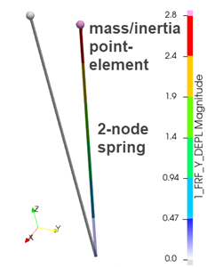

### 4.2 2_cubes_assembly

This is an assembly template with 2 cubes glued via a TIED pair, plus 2 soft couplings: one for loads and one for constraints.

This case covers multi-loadcase statics, modal & forced response. It also has a model from when I added the pressure loads. Check the folder out for all.

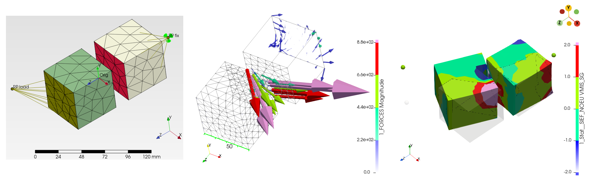

### 4.3 Shells_bracket

Same setup as the previous assembly but with low order shells.
This case covers multi-loadcase statics & modal analysis.

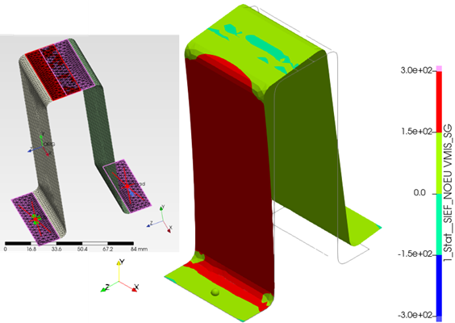

NOTE: I found shells in general in code_aster a bit of a nightmare, to handle them in the input deck, but also to show results in paraview. The translator does the best it can, and it seems to work with low order TRIAs and QUADs. The high-order ones are very odd in code_aster as they have an additional face mid-node vs traditional ones. There you go ...

### 4.4 Shaft_bear

This starts moving towards a more realistic mechanical assembly comprising a shaft, a bearing with inner & outer races, [ 2 x soft couplings + spring ] to control the axial, radial and tilting stiffness of the bearing. Then it also features a large off center end solid lump with a mass/inertia point-element attached to a soft coupling reference node, so that we get a more realistic non-symmetric response in the linear dynamics parts. This was the other assembly model that Calculix couldn't do at the time.

This case covers multi-loadcase statics, modal & forced response (shock wave ACC) analysis. It also has a Sub-model case for stress prediction methods.

> PrePoMax assembly and bearing modelling details

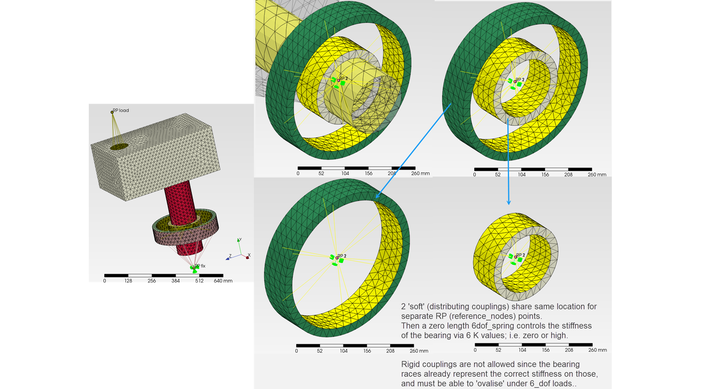

> Forced response animation
<!-- markdownlint-disable MD033 -->
<p align="center">
  <video src="examples/assets/X_forced_R2_shaft_bear.mp4" width="50%" controls></video>
</p>
<!-- markdownlint-enable MD033 -->

> Sub-Model results

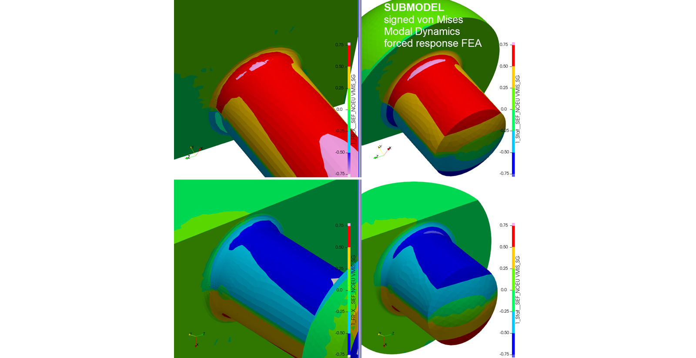

Ignore absolute values shown on stresses, these are driven by unit-like loads to illustrate methods. In linear methods with unit-loads you can also use scale & combine to get the result you need for a given input without having to re-run large models, if that was the case.

### 4.5 Bolt_preloads

In this folder there are a number of models as I was implementing the bolt pre-tension load in code_aster.

> 1 bolt: R3_M14_bolt.pmx

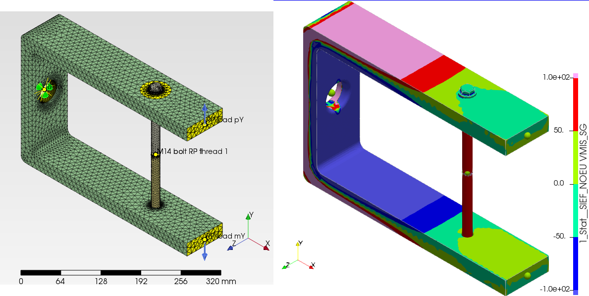

> 1 bolt on a slice (with radial symmetry) of a housing: global_R3_1_bolt.pmx

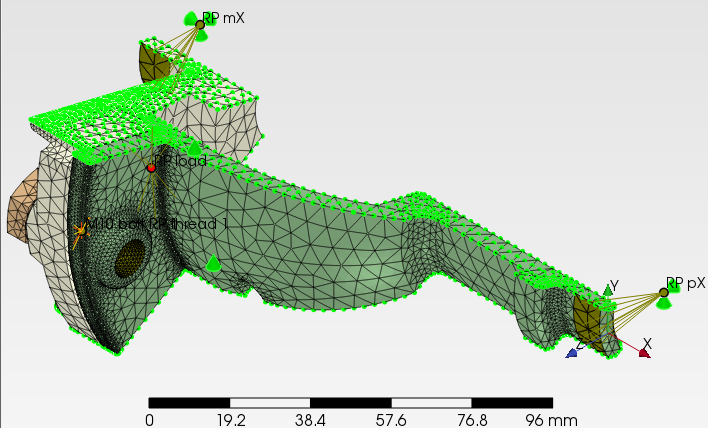
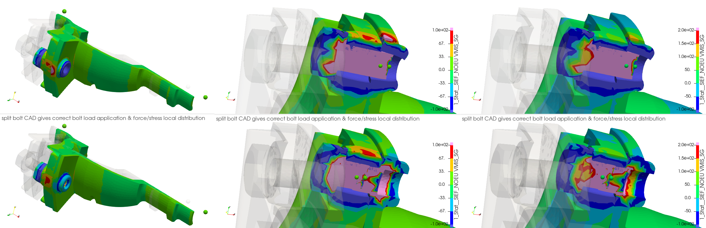

> 8 bolt housing assembly: global_R3_assy_8bolts.pmx

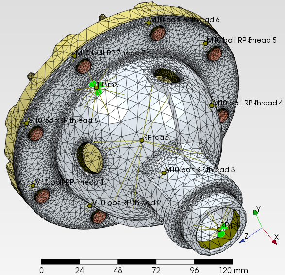

> Signed von Mises: 8 bolt housing assembly vs 1 bolt slice

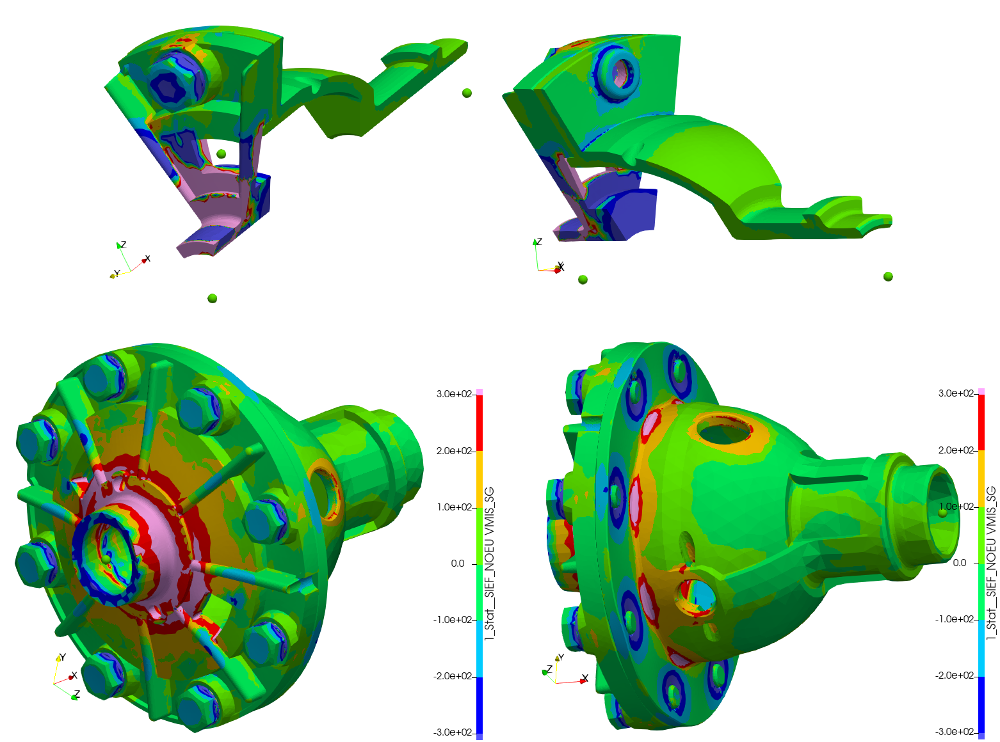

> Forced response animation: shock wave in X
<!-- markdownlint-disable MD033 -->
<p align="center">
  <video src="examples/assets/1_forced_X_R3_assy_8bolts.mp4" width="50%" controls></video>
</p>
<!-- markdownlint-enable MD033 -->

> Forced response animation: shock wave in Z
<!-- markdownlint-disable MD033 -->
<p align="center">
  <video src="examples/assets/1_forced_Z_R3_assy_8bolts.mp4" width="50%" controls></video>
</p>
<!-- markdownlint-enable MD033 -->

> Sub-Model: sub0_R3_assy_8bolts.pmx

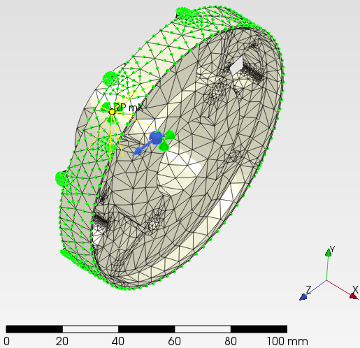

> Sub-Model (coarse) vs Global signed von Mises Stress: check method works, same stresses

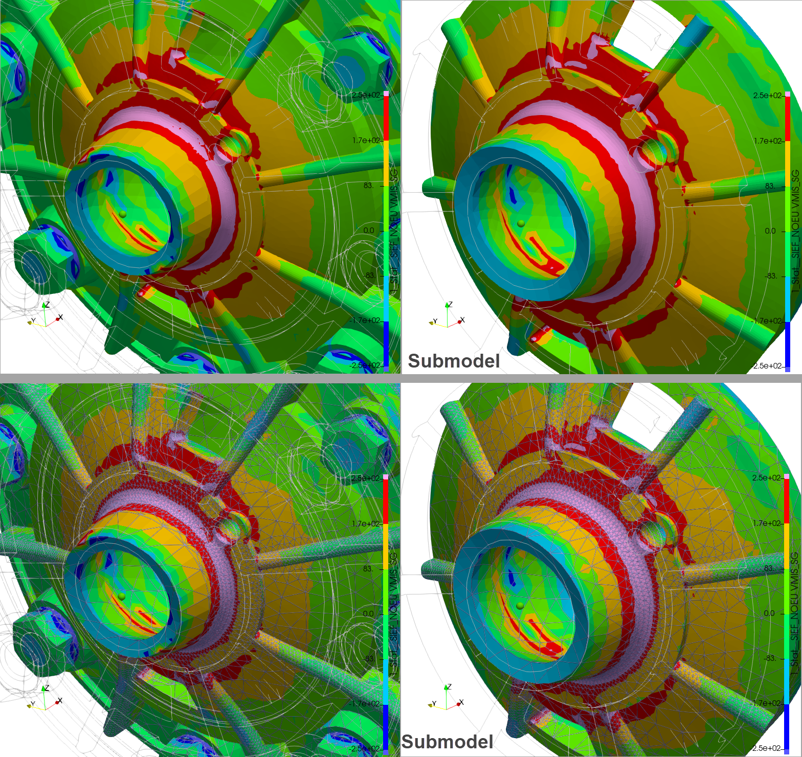

The model above was a check on the sub-modelling method, then you can refine the local model and start getting more accurate stress levels on fillets and blends.

> Sub-Model_0 vs Sub-Model_1 with a design iteration and finer mesh

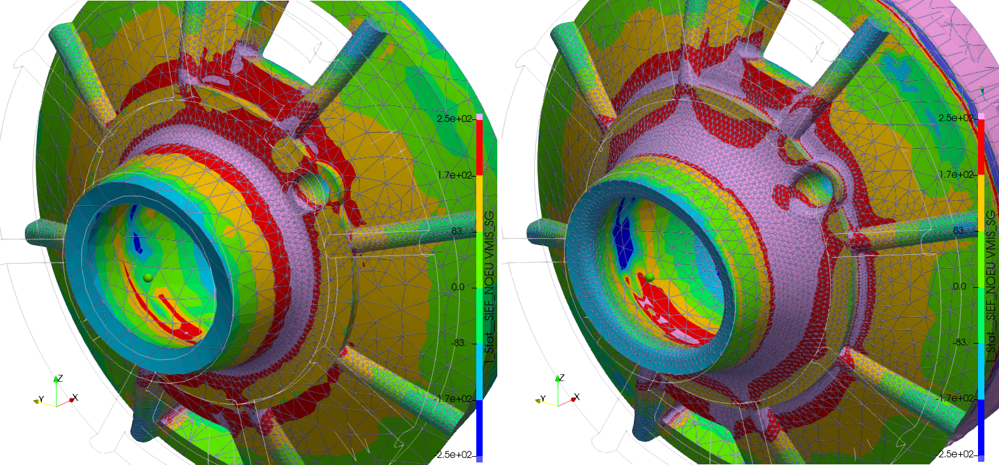

Sub-modelling can be used in a creative manner, with local design changes on fillets, as long as the global stiffness doesn't change. The figure above is only a crude example to show a sub-model daisy chain method where we refine the mesh plus we try small changes to the fillets on the fly, without having to re-model and re-run the Global main assembly. These methods should be used with care!
